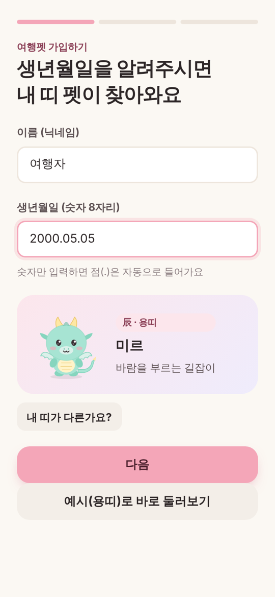
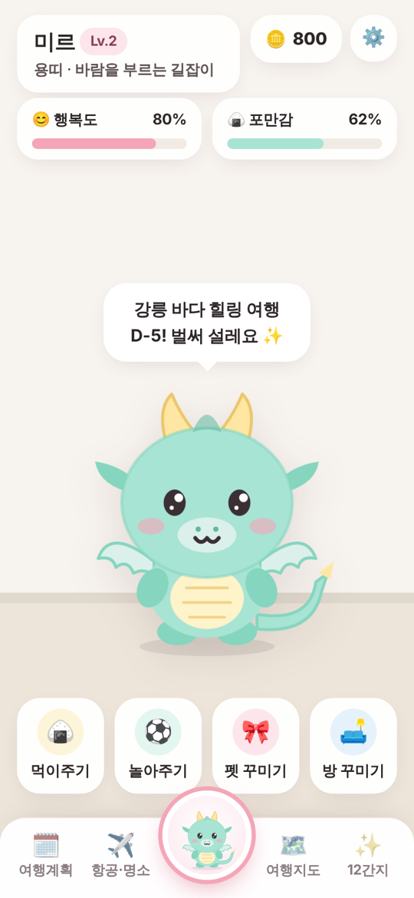
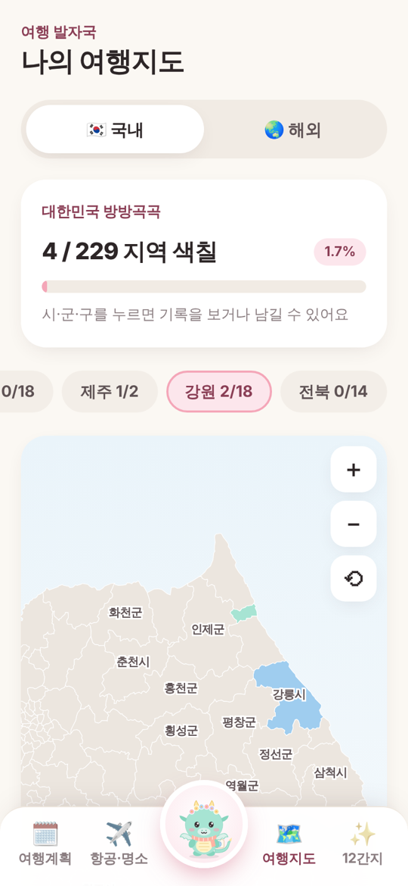
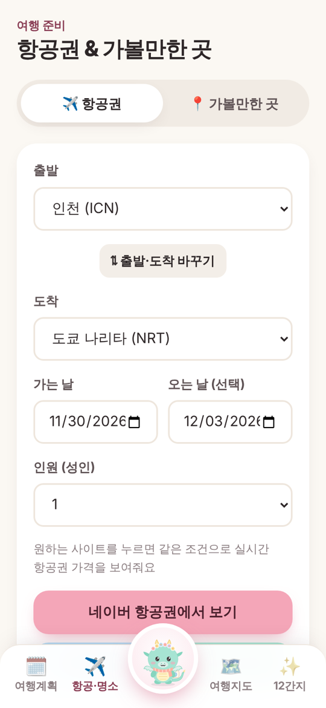
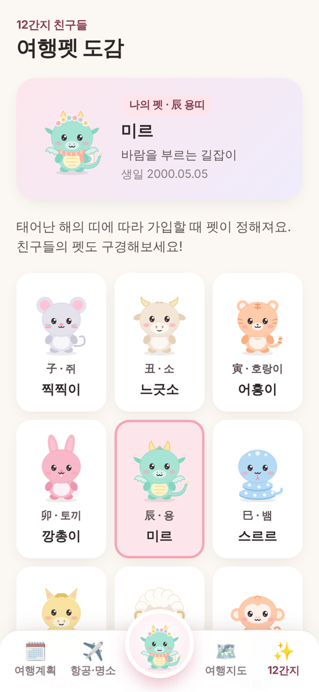

# 🐉 여행펫 (TravelPet)

**내 띠 펫과 함께 떠나는 여행 앱**

생년월일을 넣으면 12간지 중 내 띠 펫이 찾아와요.
여행을 계획하고, 다녀온 곳을 지도에 색칠하고, 받은 보상으로 펫과 펫의 방을 꾸며보세요.

### 👉 [웹에서 바로 열기](https://hyunju265996-oss.github.io/myapp/)

설치 없이 휴대폰과 PC 브라우저에서 바로 열려요. 휴대폰에서 **홈 화면에 추가**하면 앱처럼 쓸 수 있어요.

<table>
  <tr>
    <td align="center"><br><sub>생년월일로 띠 펫 결정</sub></td>
    <td align="center"><br><sub>처음엔 텅 빈 방</sub></td>
    <td align="center"><br><sub>꾸밀수록 화려해져요</sub></td>
  </tr>
  <tr>
    <td align="center"><br><sub>시·군·구 단위 색칠 지도</sub></td>
    <td align="center"><br><sub>항공권 검색</sub></td>
    <td align="center"><br><sub>12간지 펫 도감</sub></td>
  </tr>
</table>

---

## ✨ 주요 기능

### 🐾 내 띠 펫
- **생년월일을 넣으면 띠가 자동으로 정해져요.** 1~2월생은 그해 설날 전인지까지 따져서 계산해요.
- 쥐부터 돼지까지 **12가지 귀여운 캐릭터**가 있고, 펫 색은 처음에 고르고 나중에 다시 바꿀 수 있어요.
- **먹이주기 · 놀아주기 · 펫 꾸미기**(모자·안경·목·소품) · **방 꾸미기**(가구·벽지·바닥)를 할 수 있어요.
- 처음엔 빈 방에서 시작하고, 레벨이 3·6·9가 되면 반짝이 → 오라 → 천사 링이 생겨요.

### 🗺️ 여행지도 색칠하기
- **국내**: 강릉·속초·삼척처럼 **전국 229개 시·군·구**로 나뉘어 있어요.
- **해외**: 나라를 누르면 **주·도·현 단위**로 자세히 나뉘어요.
- 다녀온 횟수에 따라 색이 진해지고, 색칠된 곳을 누르면 그곳의 여행 기록(사진·메모·기분)을 볼 수 있어요.
- 기록을 남기면 코인을 받아요. 1건에 🪙100, 처음 간 곳은 🪙50을 더 줘요.

### 🗓️ 여행 계획
- 실제 지도 위에 일차별 일정을 번호 핀과 경로로 보여줘요.
- 장소를 검색하거나 추천 장소에서 골라 일정에 담을 수 있어요.
- **동행 초대**: 초대 링크를 보내면 친구 앱에도 같은 여행 계획이 추가돼요.

### ✈️ 항공권 & 가볼만한 곳
- 출발·도착·날짜·인원을 고르면 **네이버 항공권 · 구글 항공편 · 스카이스캐너**에서 실제 가격을 보여줘요.
- 국내·해외 추천 명소를 지도와 목록으로 보고 바로 계획에 담을 수 있어요.

---

## 🚀 사용 방법

| 방법 | 설명 |
|---|---|
| **웹에서 열기** | https://hyunju265996-oss.github.io/myapp/ |
| **파일로 열기** | [`travelpet/travelpet.html`](travelpet/travelpet.html)을 내려받아 브라우저로 열기 (파일 하나에 앱 전체가 들어 있어요) |
| **예시로 둘러보기** | 첫 화면에서 **"예시(용띠)로 바로 둘러보기"**를 누르면 용띠 펫 '미르'와 예시 기록으로 시작해요 |

PC에서 열면 스마트폰 프레임 안에 앱이 보이고, 휴대폰에서는 화면에 꽉 차게 보여요.

### 구글 지도 (선택)
**API 키 없이도 모든 기능이 동작해요.** 기본으로는 무료 지도(OpenStreetMap)를 써요.

구글 지도로 바꾸고 싶다면:
1. Google Cloud에서 **Maps JavaScript API**와 **Places API (New)**를 켜요.
2. 키 제한에서 웹사이트 주소 `https://hyunju265996-oss.github.io/*`만 허용해요.
3. 앱 홈 오른쪽 위 **⚙️ 설정**에 키를 넣고 저장해요.

---

## 📁 폴더 구조

```
myapp/
├── index.html              # GitHub Pages에서 열리는 앱 (단일 파일)
├── travelpet/              # 앱 원본 (수정할 때 여기를 고쳐요)
│   ├── index.html
│   ├── travelpet.html      # 원본을 하나로 묶은 단일 파일
│   ├── css/app.css
│   ├── js/
│   │   ├── zodiac.js       # 생년월일 → 띠 계산 (설날 기준)
│   │   ├── pets.js         # 12간지 캐릭터 · 꾸미기 아이템 (SVG)
│   │   ├── mapview.js      # 구글 지도 / OpenStreetMap
│   │   └── screens/        # 화면별 코드
│   ├── data/               # 국내 시·군·구, 세계 지도 경계 데이터
│   ├── vendor/             # d3, topojson, Leaflet
│   └── figma/              # 피그마용 캐릭터 SVG · 화면 원본
└── docs/screenshots/       # README 이미지
```

빌드 과정이 없는 순수 HTML · CSS · JavaScript 앱이에요.

---

## 📝 알아두기

- 펫과 여행 기록은 **사용하는 기기의 브라우저에만 저장**돼요. 다른 기기와 자동으로 맞춰지지 않아요.
- 동행 초대는 여행 계획을 링크에 담아 주고받는 방식이에요. 여러 명이 동시에 편집하려면 서버(예: Firebase)를 붙여야 해요.

## 🙏 데이터 출처

- 국내 시·군·구 경계: [vuski/admdongkor](https://github.com/vuski/admdongkor) (2025년 10월 기준 행정동을 시·군·구로 합침)
- 해외 주·도 경계: [Natural Earth](https://www.naturalearthdata.com/) (퍼블릭 도메인)
- 지도: [OpenStreetMap](https://www.openstreetmap.org/copyright) · [Leaflet](https://leafletjs.com/) · [D3](https://d3js.org/)
